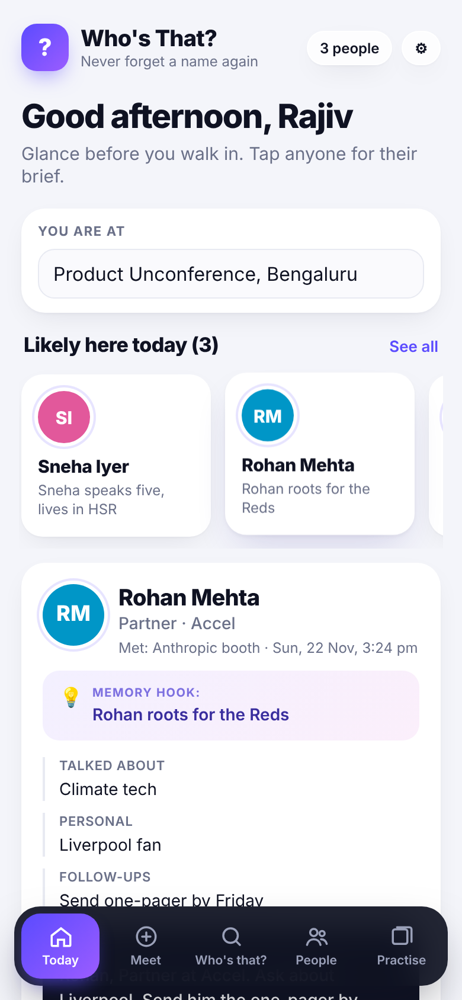
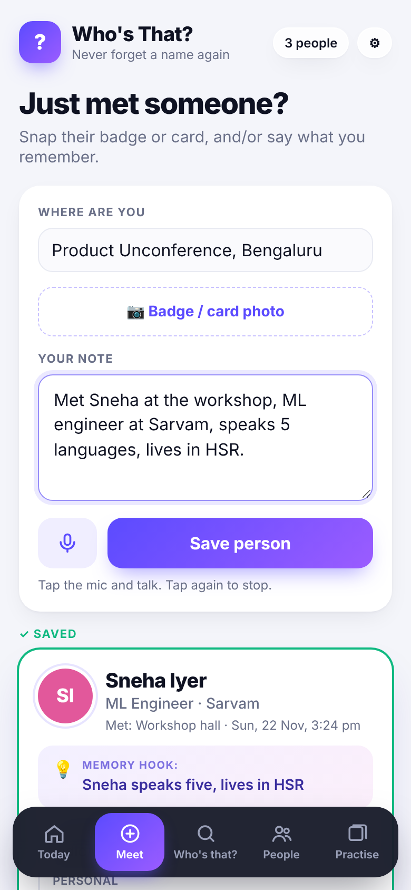
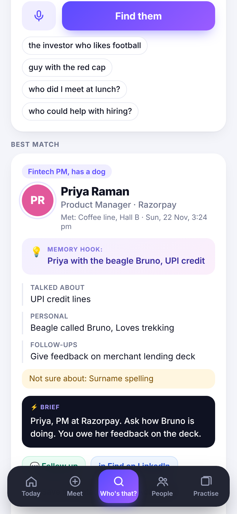
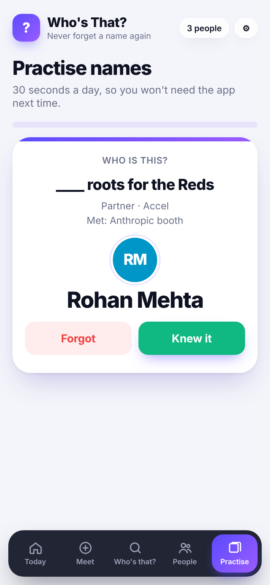

# Who's That?

**Never forget a name again.** Built solo in 4 hours at the Product (Un)Conference '26 Builder's Day, Bengaluru, using Claude.

You meet dozens of people over coffee, in elevators and at events. Two days later you see one of them again, you know you've met, and the name is gone. Who's That? fixes that moment.

> We remember people by context, not by name. Contact apps search by name. Who's That? searches by memory.

| Today | Meet | Who's that? | Practise |
|---|---|---|---|
|  |  |  |  |

## What it does

1. **Capture in 10 seconds.** Right after an intro, snap their badge or business card and/or say a quick note ("Priya, PM at Razorpay, has a beagle called Bruno, will send her deck"). Claude turns it into a contact card with role, topics, personal details, follow-ups and a **memory hook** that ties the name to a detail.
2. **Zero-search recall.** The **Today** screen shows who you're likely to run into where you are right now, so you can glance before walking in.
3. **Find by fuzzy memory.** "The fintech woman with the dog" returns Priya, why she matched, and a 2-line brief to greet her with.
4. **Follow through.** One tap drafts a personal WhatsApp or email follow-up. All promises from all conversations land in one **Follow-ups** list.
5. **Train your memory.** **Practise** uses spaced-repetition flashcards ("____ with the beagle Bruno") so eventually you don't need the app.

Also: save to phone contacts (.vcf), LinkedIn lookup, voice input, "Add detail" to update a card later, and JSON/CSV backup.

## Privacy by design

No face recognition and no scraping. The app only remembers what **you** chose to note down. Contacts are stored locally in your browser (or privately in your own Claude account in the claude.ai version).

## How it was built

- **Claude Console Playground:** designed and tuned the four prompts (capture with vision, find, follow-up, brief): structured JSON output, no-invention rules, uncertainty flags. See [`/prompts`](prompts).
- **Claude Messages API:** the app sends exactly those requests, with image input for badges.
- **Front end:** a single self-contained HTML file. No build step, no backend, no dependencies.

## Run it

1. Download `index.html` and open it in Chrome (or use the GitHub Pages link below).
2. Get an API key at [platform.claude.com](https://platform.claude.com) under **API keys**.
3. Paste the key in the settings box and save. Set the model to one your Console account offers (default `claude-opus-5-5`).

Your key stays in your browser's local storage and is only sent to `api.anthropic.com`. Never commit a key to this repo.

### claude.ai version

[`claude-ai-version/index.html`](claude-ai-version/index.html) is the same app built for claude.ai artifacts. It needs no API key: each user signs in with their own Claude account and contacts sync privately across their devices. Live: https://claude.ai/artifact/1oFGfZVf3uRQbpfvJNNgtu

## Roadmap

- Calendar briefs: "You're meeting Rohan in 10 minutes, he's a Liverpool fan, you owe him a one-pager."
- WhatsApp bot capture: forward a voice note, contact saved.
- Morning digest when you arrive at a venue.
- Opt-in mutual Bluetooth proximity: "Priya is nearby."
- Team mode for sales and BD teams; event mode for organisers.

## Who pays

Salespeople, recruiters, founders who are fundraising, community managers, frequent event-goers, and event organisers who could bundle it for attendees.

---

Built by Rajiv Reddy with Claude.
